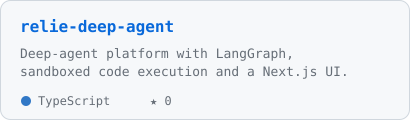
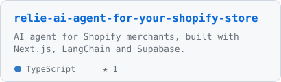
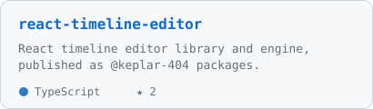
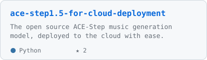
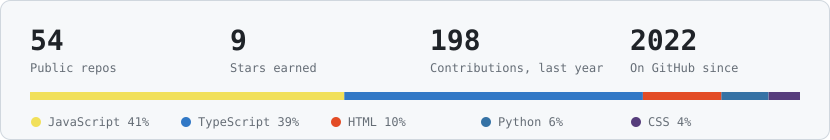

<a href="https://github.com/keplar-404">
  <picture>
    <source media="(prefers-color-scheme: dark)" srcset="dark_mode.svg">
    
  </picture>
</a>

### 👋 About

Full-stack developer building AI agents, LLM-powered apps and developer tooling. I work mostly in TypeScript and Python, and I maintain [react-timeline-editor](https://github.com/keplar-404/react-timeline-editor).

### 🚀 Featured projects

<a href="https://github.com/keplar-404/relie-deep-agent"><picture><source media="(prefers-color-scheme: dark)" srcset="assets/relie-deep-agent_dark.svg"></picture></a>
<a href="https://github.com/keplar-404/relie-ai-agent-for-your-shopify-store"><picture><source media="(prefers-color-scheme: dark)" srcset="assets/relie-ai-agent-for-your-shopify-store_dark.svg"></picture></a>
<a href="https://github.com/keplar-404/react-timeline-editor"><picture><source media="(prefers-color-scheme: dark)" srcset="assets/react-timeline-editor_dark.svg"></picture></a>
<a href="https://github.com/keplar-404/ace-step1.5-for-cloud-deployment"><picture><source media="(prefers-color-scheme: dark)" srcset="assets/ace-step1.5-for-cloud-deployment_dark.svg"></picture></a>

### 🛠️ Tech stack

<b>Languages</b> 

  
<b>Frontend</b> 

  
<b>Backend</b> 

  
<b>Database</b> 

  
<b>AI</b> 

  
<b>Platforms</b> 

  
<b>Tools</b> 

  
<b>Environment</b> 

  

### 📊 GitHub stats

<picture><source media="(prefers-color-scheme: dark)" srcset="assets/stats_dark.svg"></picture>
